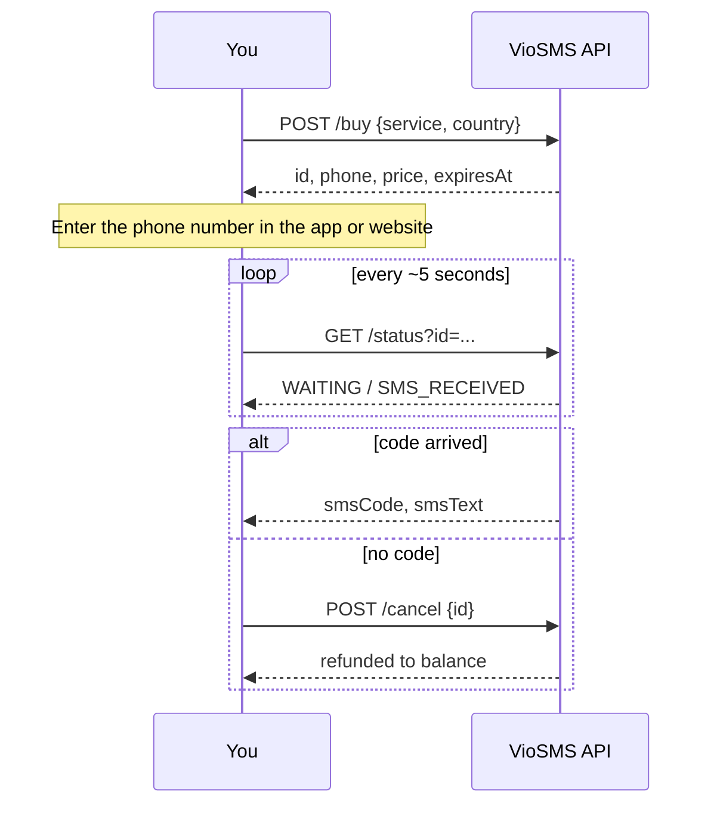

# VioSMS API: receive SMS verification codes with virtual numbers

[](openapi/openapi.json)
[](LICENSE)
[](https://vio-sms.com/api-docs)

Official examples for the [VioSMS](https://vio-sms.com) REST API. Rent a temporary
phone number, receive the SMS verification code (OTP) for WhatsApp, Telegram,
Google, Instagram and 800+ other services, and get the money back automatically
if no code arrives.

Numbers are available in 190+ countries. You pay per activation from your balance,
there's no subscription.

- [Quick start](#quick-start)
- [How an activation works](#how-an-activation-works)
- [Endpoints](#endpoints)
- [Examples](#examples): [cURL](examples/curl/viosms.sh) · [Python](examples/python/viosms.py) · [Node.js](examples/node/viosms.mjs) · [PHP](examples/php/viosms.php)
- [Errors](#errors)
- [Moving from SMS-Activate](#moving-from-sms-activate)
- [FAQ](#faq)

## Quick start

1. Create a free account at [vio-sms.com](https://vio-sms.com) and top up your balance.
2. Copy your API key from the **Profile** page.
3. Send it as a Bearer token:

```bash
export VIOSMS_API_KEY=your_key

curl https://vio-sms.com/api/v1/balance \
  -H "Authorization: Bearer $VIOSMS_API_KEY"
```

```json
{ "status": "success", "balance": 15.5, "currency": "USD" }
```

Buy a WhatsApp number in the United Kingdom (country `16`) and check it for a code:

```bash
curl https://vio-sms.com/api/v1/buy \
  -H "Authorization: Bearer $VIOSMS_API_KEY" \
  -H "Content-Type: application/json" \
  -d '{"service": "wa", "country": "16"}'

curl "https://vio-sms.com/api/v1/status?id=ACTIVATION_ID" \
  -H "Authorization: Bearer $VIOSMS_API_KEY"
```

Every example in this repo does the full flow (buy, wait for the code, cancel and
refund if nothing comes) and can be run from the command line:

```bash
python examples/python/viosms.py wa 16
node examples/node/viosms.mjs wa 16
php examples/php/viosms.php wa 16
bash examples/curl/viosms.sh wa 16
```

## How an activation works



Rules worth knowing before you build on it:

- **One number, one activation.** A number is valid for **20 minutes** and is used for
  a single verification. It can't receive calls.
- **No code, no charge.** If no SMS arrives within 20 minutes, the activation is
  cancelled automatically and the price goes back to your balance.
- **Cancel early for a faster refund.** `POST /cancel` is allowed **2 minutes** after
  buying. Before that you get `400` with a `Retry-After` header.
- **Pick the country with data.** Delivery rates differ by country and change during the
  day. The [statistics page](https://vio-sms.com/statistics) ranks countries per service
  by the last 24 hours of real activations.
- **Repeated failures block a service for a while.** After many failed activations in a
  row, `/buy` returns `403 service_blocked` with `Retry-After` for that service.
- Prices are in USD. Your loyalty discount is already applied to the price `/buy` returns.

## Endpoints

Base URL: `https://vio-sms.com/api/v1`  
Auth: `Authorization: Bearer <API_KEY>` on every request.

| Method | Path | What it does |
| --- | --- | --- |
| `GET` | `/balance` | Current balance in USD |
| `GET` | `/services` | All services with their code and lowest current price |
| `GET` | `/countries` | All countries with the code to use in `/buy` |
| `POST` | `/buy` | Buy a number. Body: `service`, `country`, optional `operator` (default `any`) |
| `GET` | `/status?id=` | Activation status, plus `smsCode` and `smsText` once the SMS arrives |
| `POST` | `/cancel` | Cancel a waiting activation and refund it. Body: `id` |

Fetch service and country codes from `/services` and `/countries` instead of
hard-coding long lists. The full spec is in [`openapi/openapi.json`](openapi/openapi.json):
import it into Postman, Insomnia or Swagger Editor, or generate a client with
[OpenAPI Generator](https://openapi-generator.tech).

### Activation status

| Status | Meaning |
| --- | --- |
| `WAITING` | Number is active, no SMS yet |
| `SMS_RECEIVED` | The code arrived, read `smsCode` / `smsText` |
| `COMPLETED` | Code received and the 20-minute window has ended |
| `CANCELLED` | Cancelled by you or expired; the price was refunded |

Example `/status` response:

```json
{
  "status": "success",
  "data": {
    "id": "cmabc123xyz",
    "status": "SMS_RECEIVED",
    "phone": "+447700900123",
    "smsCode": "456789",
    "smsText": "Your WhatsApp code: 456-789"
  }
}
```

## Examples

| Language | File | Requirements |
| --- | --- | --- |
| cURL / Bash | [`examples/curl/viosms.sh`](examples/curl/viosms.sh) | `curl`, `jq` |
| Python | [`examples/python/viosms.py`](examples/python/viosms.py) | Python 3.8+, `requests` |
| Node.js | [`examples/node/viosms.mjs`](examples/node/viosms.mjs) | Node.js 18+, no dependencies |
| PHP | [`examples/php/viosms.php`](examples/php/viosms.php) | PHP 7.4+ with `curl` |

The Python, Node.js and PHP files are also small client classes you can copy into
your project:

```python
from viosms import VioSMS

client = VioSMS("your_key")
number = client.buy("wa", "16")
activation = client.wait_for_code(number["id"])
```

```js
import { VioSMS } from './viosms.mjs';

const client = new VioSMS(process.env.VIOSMS_API_KEY);
const number = await client.buy('wa', '16');
const activation = await client.waitForCode(number.id);
```

## Errors

Failed requests return an HTTP status code and a JSON body with an `error` field.
Branch on the status code, not on the error text.

| Code | When | What to do |
| --- | --- | --- |
| `400` | Missing parameter, service not sold in that country, cancel too early, code already received | Fix the request; for early cancel wait `retryAfter` seconds |
| `401` | Missing or wrong API key | Check the `Authorization` header |
| `402` | Not enough balance (`balance` and `required` are in the body) | Top up |
| `403` | Account suspended, or `service_blocked` after repeated failed activations | Wait for `Retry-After` seconds or use another service |
| `404` | No activation with this id on your account | Check the id |
| `500` | No numbers in stock right now (nothing is charged), or internal error | Try another country |
| `503` | Cancel temporarily failed | Retry |

## Moving from SMS-Activate

SMS-Activate shut down on 22 December 2025. The VioSMS API is not a drop-in
replacement for its handler API: requests are JSON over REST with Bearer auth, and
the status values are words instead of `STATUS_*` strings. The operations map
one-to-one though: `getNumber` is `POST /buy`, `getStatus` is `GET /status`,
`setStatus` with `status=8` is `POST /cancel`, `getBalance` is `GET /balance`, `getPrices`
is `GET /services` and `getCountries` is `GET /countries`. See the
[migration guide](https://vio-sms.com/sms-activate-alternative) for the full table.

## FAQ

**Can I receive more than one SMS on a number?**  
A number is meant for one verification. Buy a new one for each account.

**Which country should I choose?**  
Check [vio-sms.com/statistics](https://vio-sms.com/statistics) for the countries with
the best delivery rate for your service over the last 24 hours.

**How often should I poll `/status`?**  
About every 5 seconds. Most codes arrive within seconds to a few minutes.

**Where can I see prices?**  
`GET /services` returns the lowest current price per service, and the price for
each country is shown on [vio-sms.com](https://vio-sms.com) before you buy.

## Support

- API reference: [vio-sms.com/api-docs](https://vio-sms.com/api-docs)
- Email: [support@vio-sms.com](mailto:support@vio-sms.com)
- Telegram: [@viosms](https://t.me/viosms)

Found a bug in an example? Open an issue or a pull request.

## License

The examples are released under the [MIT License](LICENSE).  
VioSMS is operated by Vio Digital Limited, registered in England and Wales (company no. 17335736).
